# Manual de Usuario del Sistema SICREFyM
**Sistema de Inscripción al Concurso Regional de Física y Matemáticas**  
**Universidad de Sonora — División de Ciencias Exactas y Naturales**  
*Versión 2026*

---

## Índice
1. [Introducción y Objetivos](#1-introducción-y-objetivos)
2. [Módulo de Aspirantes (Alumnos)](#2-módulo-de-aspirantes-alumnos)
   - 2.1 [Registro Inicial de Cuenta](#21-registro-inicial-de-cuenta)
   - 2.2 [Inicio de Sesión](#22-inicio-de-sesión)
   - 2.3 [Llenado del Perfil y Datos Escolares](#23-llenado-del-perfil-y-datos-escolares)
   - 2.4 [Información del Maestro Asesor o Tutor Escolar](#24-información-del-maestro-asesor-o-tutor-escolar)
   - 2.5 [Selección de Concursos](#25-selección-de-concursos)
   - 2.6 [Carga de Documentación Obligatoria](#26-carga-de-documentación-obligatoria)
   - 2.7 [Envío de la Solicitud y Monitoreo de Estatus](#27-envío-de-la-solicitud-y-monitoreo-de-estatus)
   - 2.8 [Subsanación en caso de Rechazo](#28-subsanación-en-caso-de-rechazo)
   - 2.9 [Obtención de Folio y Credencial Oficial](#29-obtención-de-folio-y-credencial-oficial)
   - 2.10 [Recuperación de Contraseña](#210-recuperación-de-contraseña)
3. [Módulo de Administradores y Revisores](#3-módulo-de-administradores-y-revisores)
   - 3.1 [Acceso al Panel Administrativo](#31-acceso-al-panel-administrativo)
   - 3.2 [Panel General y Estadísticas (Dashboard)](#32-panel-general-y-estadísticas-dashboard)
   - 3.3 [Control de Convocatoria (Apertura y Cierre Automatizado)](#33-control-de-convocatoria-apertura-y-cierre-automatizado)
   - 3.4 [Bandeja de Espera de Revisión](#34-bandeja-de-espera-de-revisión)
   - 3.5 [Mesa de Trabajo para Validación de Documentos y Asesor](#35-mesa-de-trabajo-para-validación-de-documentos-y-asesor)
   - 3.6 [Padrón Oficial de Alumnos Inscritos](#36-padrón-oficial-de-alumnos-inscritos)
   - 3.7 [Directorio General de Asistentes](#37-directorio-general-de-asistentes)
   - 3.8 [Inscripción Manual / Extemporánea](#38-inscripción-manual--extemporánea)
   - 3.9 [Cierre de Sesión Seguro](#39-cierre-de-sesión-seguro)

---

## 1. Introducción y Objetivos

El **SICREFyM** es la plataforma informática desarrollada para gestionar el ciclo de vida completo de las inscripciones al Concurso Regional de Física y Matemáticas de la Universidad de Sonora. Su propósito es garantizar la correcta acreditación de los estudiantes de bachillerato y secundaria, registrar debidamente a sus maestros asesores o tutores, facilitar la validación digital de documentos por parte del comité organizador y emitir las credenciales oficiales con folio único para el acceso a las sedes de examen.

---

## 2. Módulo de Aspirantes (Alumnos)

### 2.1. Registro Inicial de Cuenta
1. Ingrese al portal principal: `http://127.0.0.1:8000/`.
2. Presione el botón **"Registrarse"** en la esquina superior derecha o en la tarjeta de bienvenida (si la convocatoria está abierta).
3. Complete los campos obligatorios:
   * **Nombre(s)**
   * **Apellido paterno**
   * **Apellido materno**
   * **Correo electrónico** (debe ser un correo real al que tenga acceso permanente).
   * **Contraseña** (mínimo 8 caracteres).
   * **Confirmar Contraseña**.
4. Haga clic en **"Registrar"**. El sistema creará su cuenta de aspirante y lo redirigirá a su área personal.

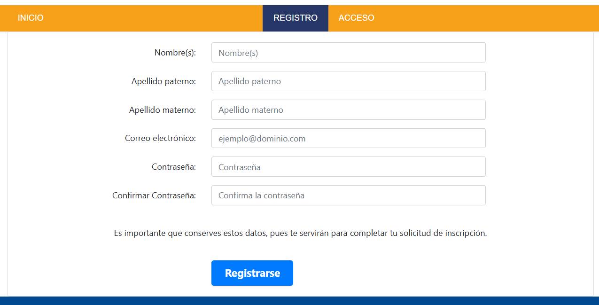

> [!NOTE]  
> Asegúrese de registrar correctamente sus nombres y apellidos con acentos, ya que estos datos se imprimirán tal cual en su diploma y credencial oficial.

### 2.2. Inicio de Sesión
1. Desde el portal principal, haga clic en **"Acceder"**.
2. Introduzca su correo electrónico y su contraseña.
3. Haga clic en **"Iniciar Sesión"**.

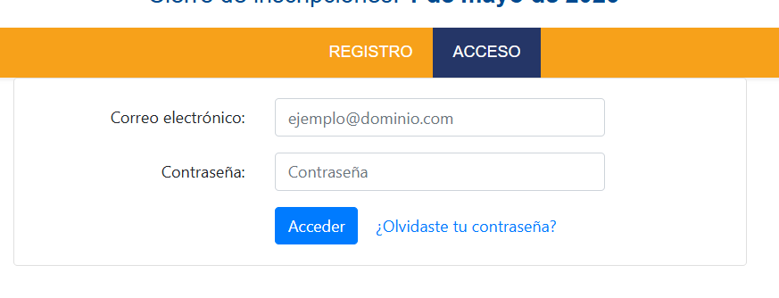

### 2.3. Llenado del Perfil y Datos Escolares
Una vez dentro, diríjase a la sección **"Perfil"**:
1. Llene su información personal y de contacto:
   * **CURP:** 18 caracteres alfanuméricos en mayúsculas.
   * **Fecha de nacimiento:** Seleccione día, mes y año.
   * **Teléfono:** 10 dígitos.
   * **Escuela de origen:** Escriba el nombre oficial de su institución educativa (preparatoria, bachillerato o secundaria).

   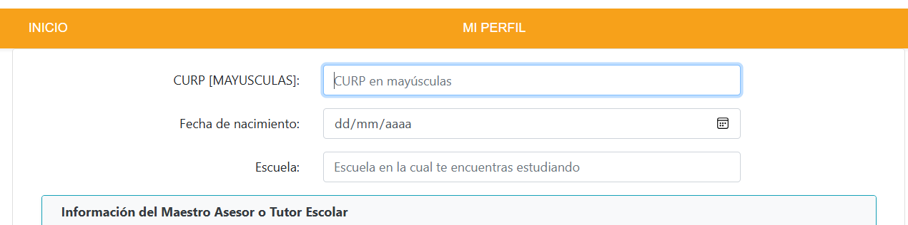

### 2.4. Información del Maestro Asesor o Tutor Escolar
En el formulario de inscripción encontrará una tarjeta dedicada para registrar a su profesor asesor:
1. Complete los datos de contacto del docente que le orienta en su preparación académica:
   * **Nombre(s) del Asesor:** Nombre(s) de pila del profesor.
   * **Apellido Paterno:** Primer apellido del asesor.
   * **Apellido Materno:** Segundo apellido (opcional).
   * **Correo Electrónico:** Dirección de correo del profesor.
   * **Teléfono del Asesor:** 10 dígitos telefónicos.
   * **Escuela del Asesor:** Institución educativa (opcional; si labora en su misma escuela se asocia automáticamente).
2. Estos datos quedarán respaldados en su expediente y se reflejarán tanto en su perfil de usuario como en las listas y constancias que emita el comité organizador.

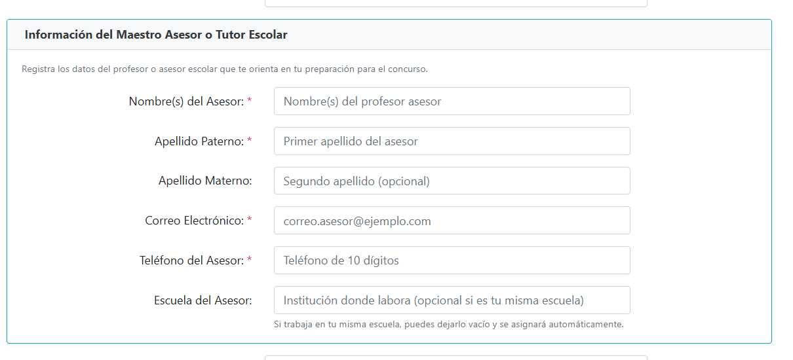

### 2.5. Selección de Concursos
En la sección **"Formulario de Inscripción"**:
1. Marque la casilla correspondiente al o los concursos en los que desea competir:
   * **Concurso Regional de Física**
   * **Concurso Regional de Matemáticas**
   * *(Puede seleccionar ambos si su categoría escolar lo permite).*

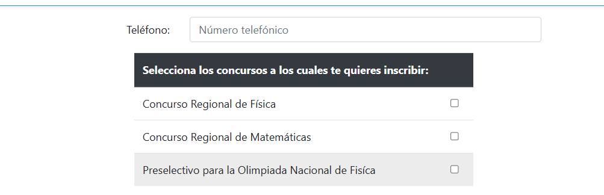

### 2.6. Carga de Documentación Obligatoria
Deberá adjuntar digitalmente **dos archivos obligatorios** en formato de imagen (`JPG`, `PNG`):

1. **Fotografía para credencial:**
   * Debe ser una foto reciente, a color, de frente, fondo blanco o claro, con rostro descubierto (estilo pasaporte o credencial escolar).
   * Al seleccionarla, la plataforma abre una ventana interactiva de recorte para encuadrarla exactamente a la proporción de la credencial oficial.
2. **Constancia o Credencial Escolar:**
   * Documento oficial que acredite que es alumno regular en el ciclo escolar actual.
   * Puede ser: constancia de estudios con sello oficial o fotografía nítida de su credencial escolar vigente.

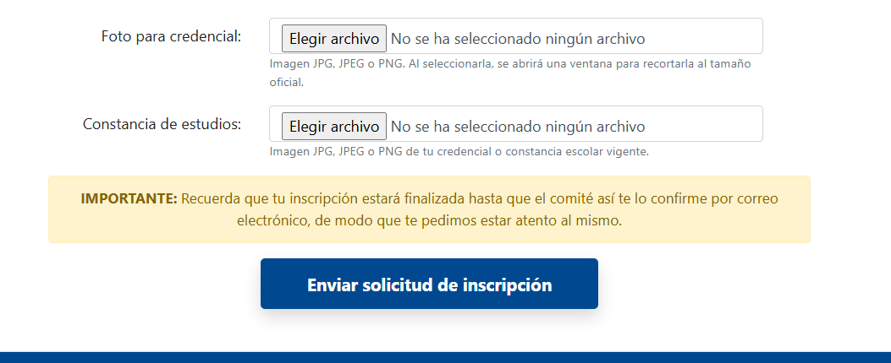

> [!IMPORTANT]  
> El **Acta de Nacimiento** ya no es un requisito obligatorio en esta edición.

### 2.7. Envío de la Solicitud y Monitoreo de Estatus
1. Una vez cargados ambos archivos, completado el asesor y el perfil, presione el botón **"Enviar Solicitud de Inscripción"**.
2. Su estatus cambiará a **"En Espera de Revisión"**.
3. Su expediente pasará a la bandeja del Comité Revisor de la UNISON. Deberá estar atento a su correo electrónico.

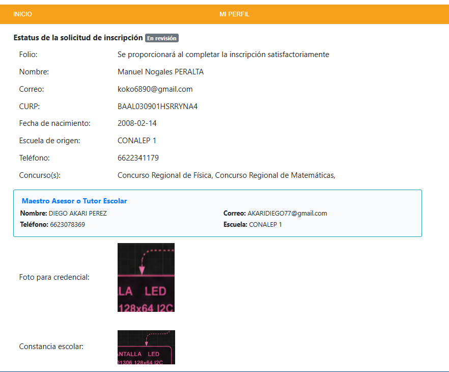

> [!NOTE]  
> Usuario de ejemplo de las imagenes proporcionadas. No son datos verdaderos.

### 2.8. Subsanación en caso de Rechazo
Si alguno de sus documentos no cumple con los criterios de legibilidad:
1. Recibirá un correo titulado *"CRFyM - Inscripción pendiente"*, indicando qué documento fue rechazado y el motivo detallado.
2. Ingrese a la plataforma y diríjase a **"Editar"**.
3. Reemplace únicamente el archivo señalado siguiendo las observaciones del revisor.
4. Presione nuevamente **"Enviar Solicitud de Inscripcion"**. Su expediente regresará a la fila de espera sin costo ni penalización.

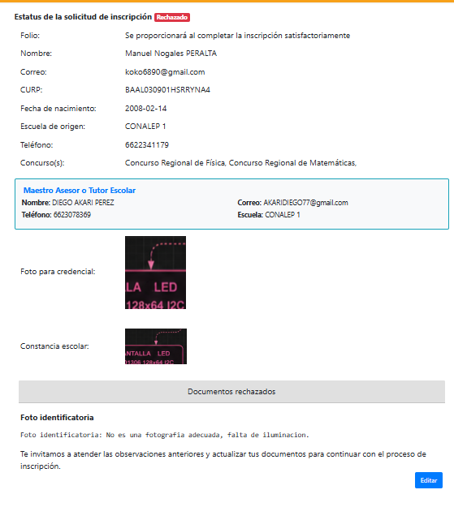
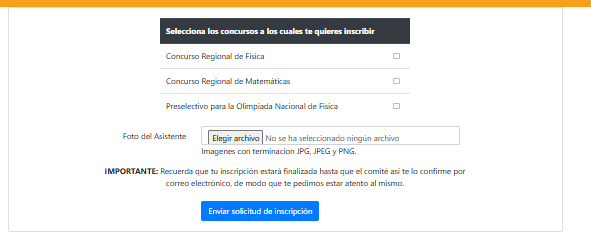

### 2.9. Obtención de Folio y Credencial Oficial
1. Cuando el revisor apruebe su documentación, recibirá un correo con el asunto *"CRFyM - Confirmación de inscripción"*.
2. El correo y su panel mostrarán su **Número de Folio Oficial** (por ejemplo: `2026-110-001`).
3. En su menú aparecerá habilitado el botón **"Descargar Credencial"**.
4. Imprima su credencial oficial con código QR y preséntela junto con una identificación el día del concurso.

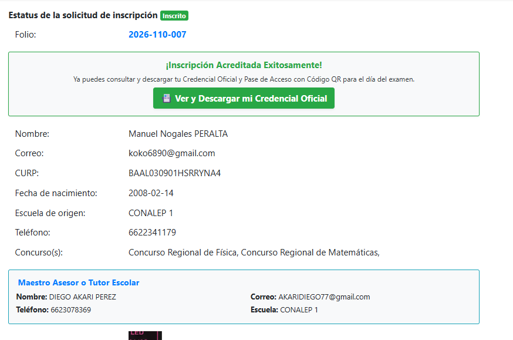
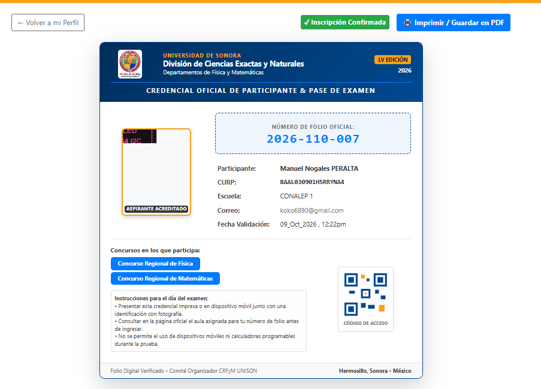

### 2.10. Recuperación de Contraseña
1. En la pantalla de login, haga clic en *"¿Olvidaste tu contraseña?"*.
2. Introduzca su correo registrado.
3. Recibirá un enlace seguro para restablecer su clave de acceso.

---

## 3. Módulo de Administradores y Revisores

### 3.1. Acceso al Panel Administrativo
1. Ingrese a la URL: `http://127.0.0.1:8000/revisores` o `http://127.0.0.1:8000/admin`.
2. Si no tiene sesión activa, el sistema le solicitará sus credenciales de Revisor.
3. El panel se compone de:
   * **Barra superior:** Muestra el nombre del revisor en turno y el botón de *Cerrar Sesión*.
   * **Menú lateral gris sobrio:** Enlaces directos y contador en tiempo real de trámites pendientes.

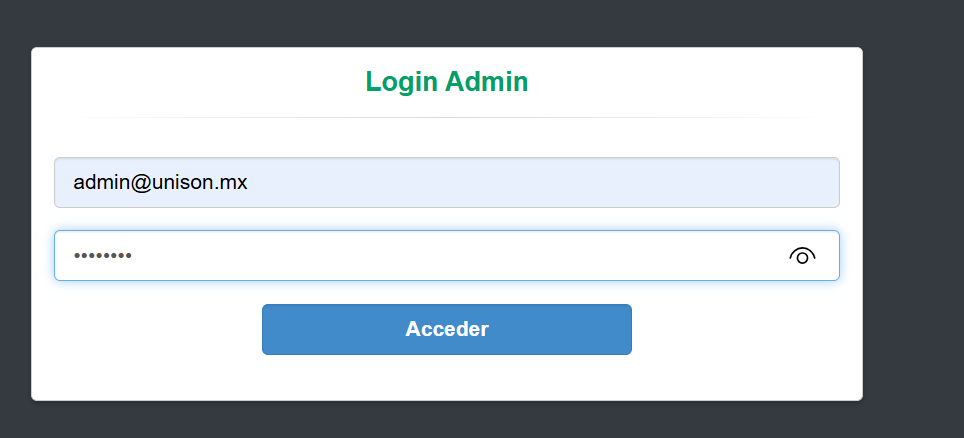
---

### 3.2. Panel General y Estadísticas (Dashboard)
Al ingresar a **"Panel General"**, encontrará:
* **Tarjetas de Monitoreo:**
  * Total de Registrados en la plataforma.
  * Solicitudes en Espera de validación.
  * Alumnos Aprobados con Folio Oficial asignado.
  * Documentos en proceso de Reenvío/Rechazo.
* **Inscripciones por Concurso:** Avance porcentual y conteo por concurso (Física y Matemáticas).

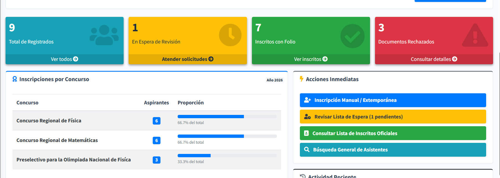
---

### 3.3. Control de Convocatoria (Apertura y Cierre Automatizado)
En la parte superior del Dashboard se incluye el módulo de **Control de Convocatoria / Estado del Concurso**:
1. **Interruptor Inmediato:**
   * Muestra un distintivo claro: **ABIERTA (Recibiendo Solicitudes)** o **CERRADA (Inscripciones Desactivadas)**.
   * Con un solo clic en **"Cerrar Convocatoria Ahora"** o **"Reabrir Convocatoria"**, el sistema bloquea o activa la recepción de nuevos aspirantes sin necesidad de comentar o modificar código en el servidor.
2. **Mensaje Oficial de Cierre:**
   * Permite redactar y guardar el aviso oficial que leerán los visitantes en la página principal cuando la convocatoria concluya.

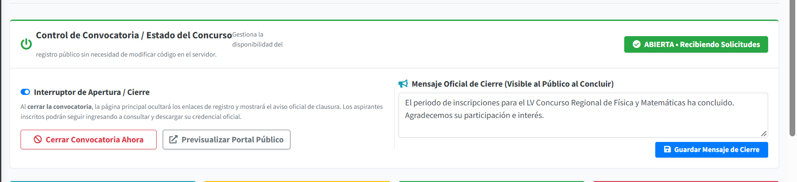
3. **Comportamiento Automático:**
   * Al cerrar la convocatoria, la página principal oculta el botón de registro y muestra una tarjeta formal con el aviso oficial configurado, manteniendo habilitado el botón de acceso para que los alumnos ya inscritos sigan consultando su credencial.

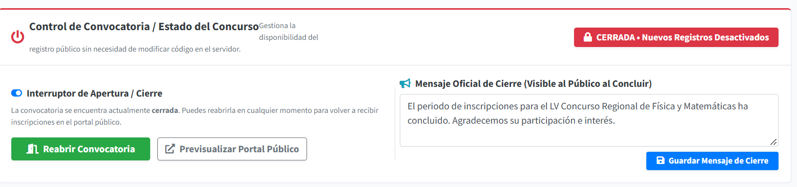

   * La ruta `/register` bloquea solicitudes directas redirigiendo con aviso preventivo.
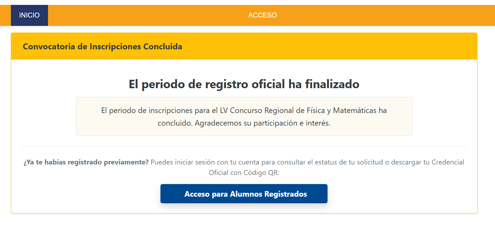

---

### 3.4. Bandeja de Espera de Revisión
Acceda mediante la opción **"En Espera de Revisión"**:
1. Muestra todas las solicitudes enviadas por los alumnos que aún no han sido dictaminadas.
2. **Buscador en tiempo real:** Escriba en la caja superior cualquier coincidencia por nombre, CURP, escuela o correo.
3. Cada fila muestra:
   * Nombre completo y CURP.
   * Escuela de origen.
   * Concursos solicitados (etiquetas azules).
   * Fecha exacta de envío.
4. Para evaluar un expediente, haga clic en el botón azul **`[Revisar y Validar]`**.

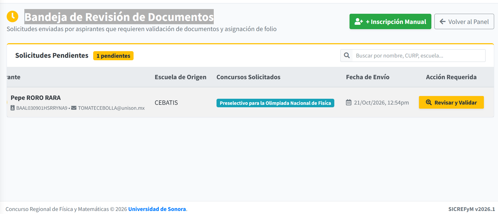
---

### 3.5. Mesa de Trabajo para Validación de Documentos y Asesor
Esta pantalla funciona como una estación de dictamen ergonómica dividida en dos columnas:

#### Columna Izquierda (Expediente del Aspirante y Asesor):
* **Ficha del Aspirante:** Muestra avatar con iniciales, nombre, CURP, fecha de nacimiento, escuela, teléfono y concursos asignados.
* **Datos del Maestro Asesor / Tutor:** Muestra el nombre completo del profesor asesor, su correo electrónico, teléfono y escuela vinculada.
* **Tarjeta de Dictamen Dinámico:** Monitorea en vivo las decisiones tomadas en la columna derecha:
  * Si ambos documentos están aceptados: Muestra alerta verde y el botón principal **`[Aprobar y Asignar Folio]`**.
  * Si se rechaza al menos un documento: La tarjeta cambia a color rojo y el botón se transforma en **`[Notificar Rechazo para Reenvío]`**.

#### Columna Derecha (Inspección de Archivos):
* **1. Fotografía para Credencial:**
  * Previsualización con dimensiones confinadas.
  * Selector tipo botón: `[Aceptar Fotografía]` o `[Rechazar]` (con campo obligatorio para redactar el motivo de rechazo).
* **2. Constancia o Credencial Escolar:**
  * Previsualización confinada y enlace a tamaño original.
  * Selector: `[Aceptar Constancia]` o `[Rechazar]` con campo de motivo.

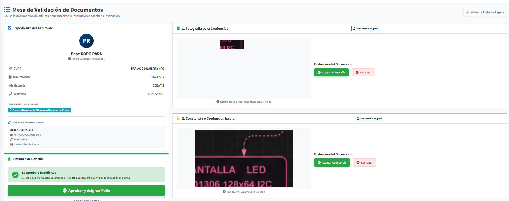
#### Finalización del Dictamen:
* **Si Aprueba:** El sistema calcula el folio con la regla oficial `Año-Concursos-Consecutivo` (ej. `2026-110-005`), almacena la fecha y su ID de revisor, y envía el correo automático de aprobación al alumno.

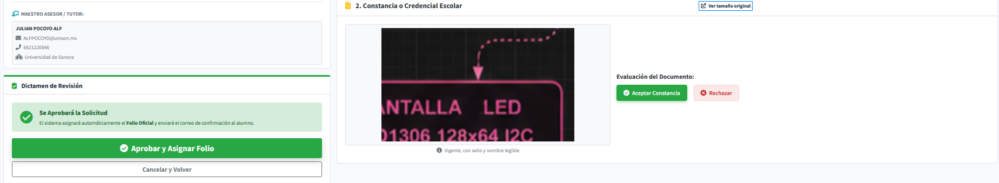

* **Si Rechaza:** El sistema compila los comentarios, marca el expediente como "Rechazado" y envía el correo con las observaciones precisas para que el alumno subsane.

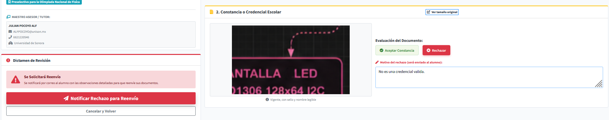

---

### 3.6. Padrón Oficial de Alumnos Inscritos
Ubicado en la opción **"Inscritos con Folio"**:
1. Contiene la lista definitiva de alumnos con número de folio asignado.
2. **Buscador predictivo:** Filtre al instante por Folio (ej. `2026-110`), apellido o escuela.
3. **Botón `[Imprimir Lista]`:** Aplica estilos limpios de impresión (ocultando barras de navegación) para emitir el listado en papel o guardar en PDF para el control de asistencia el día del examen.
4. **Botón `[Ficha]`:** Abre una ventana modal con todos los datos personales, escolares, documentación y datos completos del Maestro Asesor.

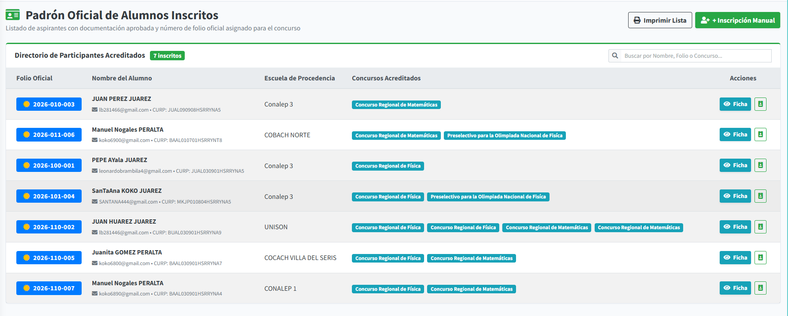
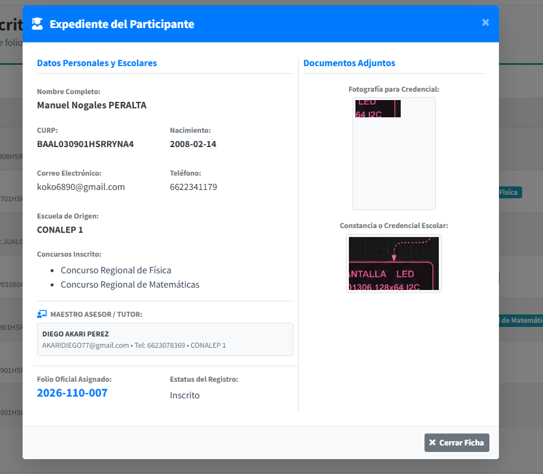
---

### 3.7. Directorio General de Asistentes
Ubicado en **"Directorio de Asistentes"**:
1. Presenta un panorama global de todos los registros en la base de datos (con o sin documentación).
2. Cuatro contadores superiores con el balance del concurso.
3. Badges de estatus por color:
   * **Inscrito** (Verde).
   * **En Espera** (Amarillo).
   * **Reenvío** (Rojo).
   * **Enviando** (Gris).
4. Botón directo de **`Validar`** disponible para cualquier alumno que se encuentre en espera, y botón **`Ficha`** con expediente completo (incluyendo al Asesor).

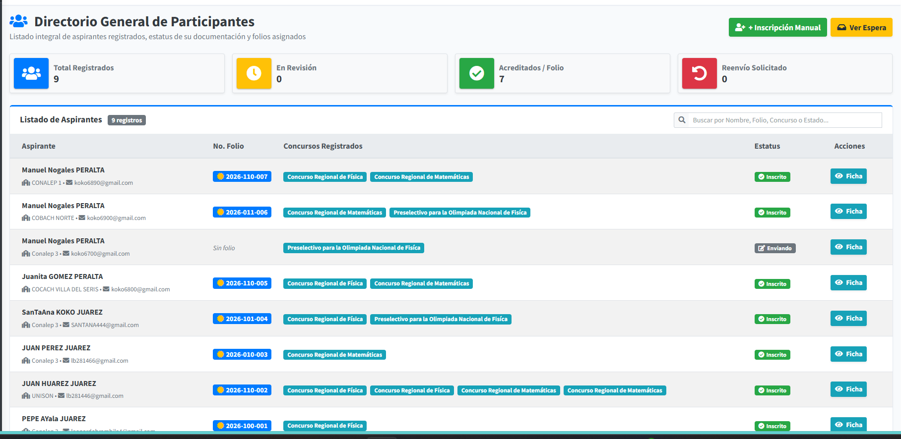
---

### 3.8. Inscripción Manual / Extemporánea
Para casos excepcionales donde un alumno acudió presencialmente o requiere registro directo:
1. En el menú lateral, haga clic en **"Inscripción Manual"**.
2. Capture:
   * Nombre(s) y Apellidos del alumno.
   * Correo electrónico.
   * CURP, fecha de nacimiento y Escuela de procedencia.
   * Concursos a los que se inscribe (Física / Matemáticas).
   * **Información del Maestro Asesor o Tutor (Opcional):** Nombre, apellidos, teléfono, correo y escuela del profesor.
3. Presione **"Inscribir y Generar Folio Oficial"**.
4. El sistema creará al asistente, vinculará al asesor y le otorgará un folio oficial de inmediato sin requerir el paso por la cola de validación web.

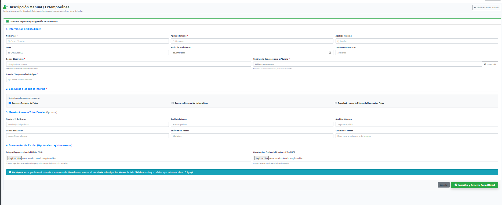
---

### 3.9. Cierre de Sesión Seguro
* Al concluir sus revisiones, haga clic en el botón **"Cerrar Sesión"** en la esquina superior derecha.
* Esto destruye la sesión del guard `revisor` y protege el acceso a la mesa de dictamen.

> [!IMPORTANT]  
> Las vistas estan sujetas al cambio, por eso no sera 100% exactas las imagenes.
